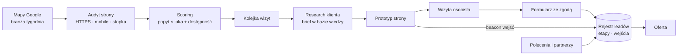
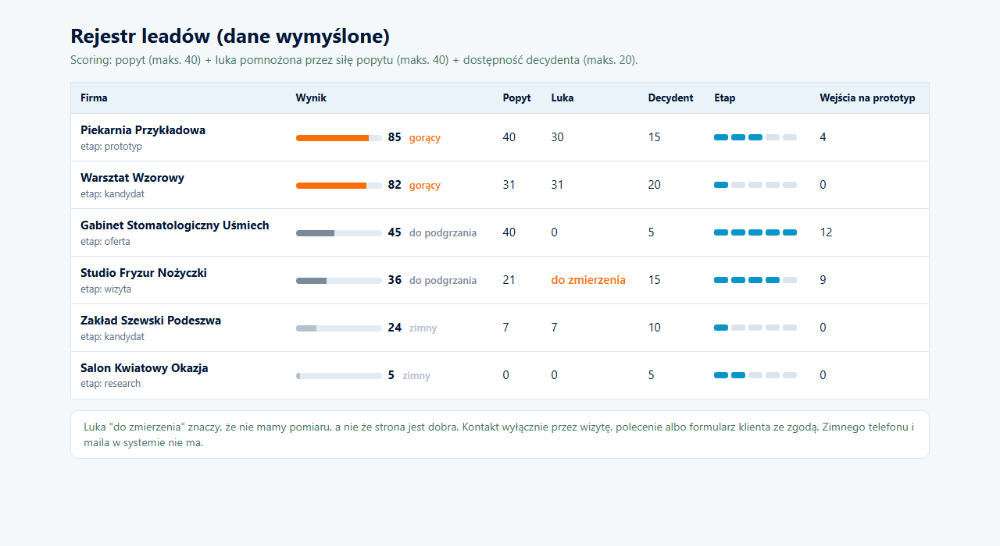

# Client Acquisition Pipeline


System pozyskiwania klientów dla lokalnej agencji AI: od kandydatów z Map, przez scoring i research, po prototyp, wizytę i ofertę. Zaprojektowany wokół prawa: bez zimnych telefonów i maili.

*Client acquisition for a local AI agency: map candidates, scoring, research, prototype, in-person visit, offer. Designed around the law: no cold calls or cold emails.*

> Wizytówka projektu. Baza leadów i dane firm są prywatne. / Showcase repository. The lead database and company data are private.

---

## PL

### Problem
Polskie prawo telekomunikacyjne (art. 398 PKE) zakazuje zimnego telefonu i zimnego maila, także między firmami. Numer z rejestru czy z Map nie jest zgodą. Klasyczny „lead gen” odpada, a czas jednej osoby na objazd jest ograniczony.

### Rozwiązanie
Lejek, w którym każdy krok jest legalny i mierzalny:
1. **Kandydaci** z Map Google dla jednej branży na tydzień, z audytem technicznym strony (HTTPS, responsywność, rok w stopce, silnik).
2. **Scoring w trzech bramkach**: dowód popytu (opinie, ocena, świeżość), widoczna luka, dostępność decydenta. Luka liczy się tylko przy popycie: punkty za lukę są **mnożone** przez siłę popytu, nie dodawane.
3. **Research klienta** (skill Claude Code): rejestry publiczne, internet, konkurencja lokalna i krajowa; wynik to brief w bazie wiedzy.
4. **Prototyp strony** pokazywany przy osobistej wizycie (patrz [AI Prototype Builder](../ai-prototype-builder)).
5. **Rejestr leadów** z etapami i licznikiem wejść na prototyp; zgoda na kontakt pochodzi z formularza wypełnionego przez klienta.
6. **Oferta**: standard z cennika albo oferta rozbudowana (skill) dla większych i nietypowych klientów.

### Architektura



### Decyzje projektowe
- **Prawo jako wymaganie architektury**, nie dopisek: kanały to wizyta, polecenie, formularz klienta. Brak modułu wysyłki zimnych wiadomości z założenia.
- **„Do zmierzenia” zamiast zera.** Gdy luki nie da się zmierzyć, wynik jest pusty, a nie zerowy; brak roku w stopce nie jest dowodem świeżej strony.
- **Najsilniejszy sygnał: firma już wydaje na klienta** (odpowiada na opinie, ma świeże opinie). Brak strony bez popytu to nie okazja.
- **Idempotencja.** Dwa przebiegi scoringu na tych samych danych dają identyczny plik; data zmiany rusza się tylko przy zmianie punktów.
- **Wejścia z testów nie liczą się jako ruch klienta** (parametr wyłączający pomiar przy każdym automatycznym otwarciu).

### Wybrany fragment kodu

```python
# Bramka 2 skalowana bramką 1: pełna luka należy się tylko firmie z pełnym dowodem popytu.
punkty_popyt = opinie_pkt + ocena_pkt                  # maks. 40
punkty_luka_bazowe, luka_zero = score_luka(strona, https, responsywna, rok_stopki, dzis)
if punkty_luka_bazowe is None:
    punkty_luka = None                                 # luka niezmierzona: nie zerujemy
else:
    punkty_luka = int(round(punkty_luka_bazowe * punkty_popyt / MAKS_POPYT))
```

### Stack
Python (zbieranie, audyt, scoring), Playwright, PageSpeed Insights API, Obsidian jako baza wiedzy (notatka na firmę, frontmatter YAML), PostgreSQL (rejestr leadów), n8n, Claude Code (skille research i oferta).

### Efekt
Jeden proces od kandydata do oferty, w całości zgodny z zakazem zimnego kontaktu. Bez płatnych baz danych: Mapy, PageSpeed i przeglądarka.

---

## EN

**Problem.** Polish telecom law (art. 398) bans cold calls and cold emails, B2B included. A number from a public registry is not consent. Classic lead gen is out, and one person's time for visits is limited.

**Solution.** A funnel where every step is legal and measurable: Google Maps candidates for one industry per week with a technical site audit; scoring in three gates (proof of demand, visible gap, reachable decision maker) where gap points are *multiplied* by demand strength; client research as a Claude Code skill producing a brief; a website prototype shown during an in-person visit; a lead registry with stages and prototype visit tracking; consent from a form the client fills in; standard or extended offer.

**Design decisions.** The law is an architecture requirement: there is no cold outreach module by design. "Unmeasured" instead of zero. Strongest signal: the business already invests in customers. Idempotent scoring. Automated visits never count as client traffic.

**Result.** One process from candidate to offer, fully compliant with the cold contact ban, using no paid data sources.

## Jak uruchomić / Run it

Przykład to działający rdzeń lejka na sześciu firmach wymyślonych: scoring w trzech bramkach, idempotentny zapis wyniku i moduł prawny, który odrzuca zimne kanały wyjątkiem. Zbieranie z Map, audyt stron, research i pomiar wejść na prototyp działają w produkcji i nie są tu zawarte.
*A working core on six invented companies: three-gate scoring, idempotent output, and a legal module that rejects cold channels with an exception. Maps collection, site audit, research and visit tracking run in production and are not included.*

```bash
pip install -r requirements.txt
python -m pytest -q                  # 17 testów
python pipeline/run_scoring.py       # scoring z data/kandydaci.json do data/wynik.json
python demo/make_demo.py             # rejestr leadów jako HTML + zrzut (playwright install chromium)
```

Struktura: `pipeline/scoring.py` (bramki), `pipeline/legal.py` (kanały dozwolone, wyjątek `ZimnyKontakt`), `pipeline/run_scoring.py` (przebieg), `data/`, `tests/`, `demo/`.

### Demo: rejestr leadów

Firma z dużym popytem i brakiem strony wygrywa z firmą bez popytu, choć ma tę samą lukę. Strona, której nie dało się zmierzyć, dostaje "do zmierzenia", a nie zero.
*A company with strong demand and no site beats one without demand despite the same gap. A site that could not be measured gets "to be measured", not zero.*



---

<p align="center"><br>
Zbudowane w <a href="https://cyfrownia.com">Cyfrowni</a>, agencji AI z Grudziądza. Kontakt: <a href="mailto:biuro@cyfrownia.com">biuro@cyfrownia.com</a></p>
